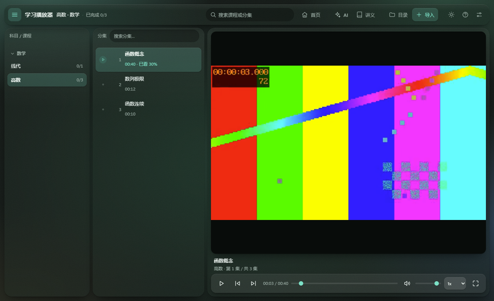
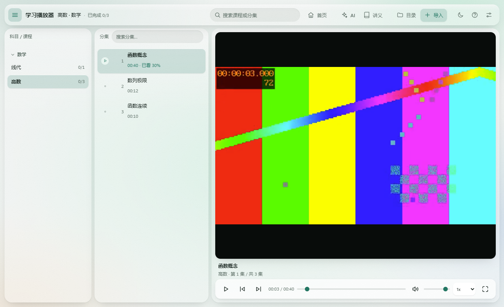
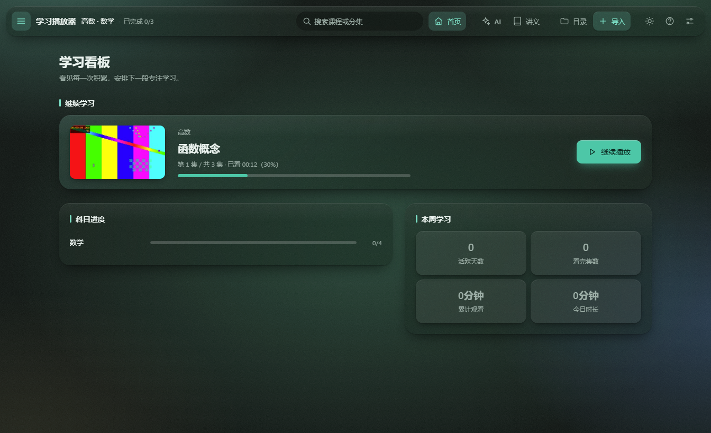
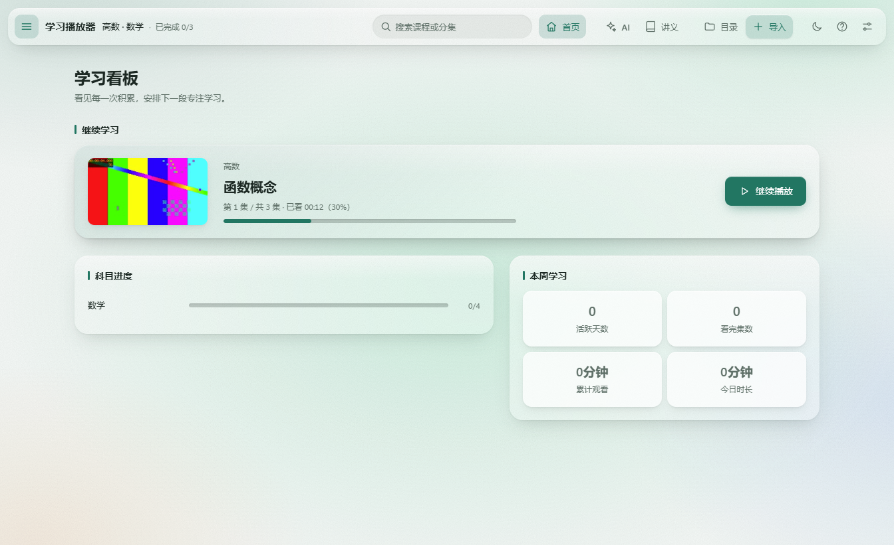
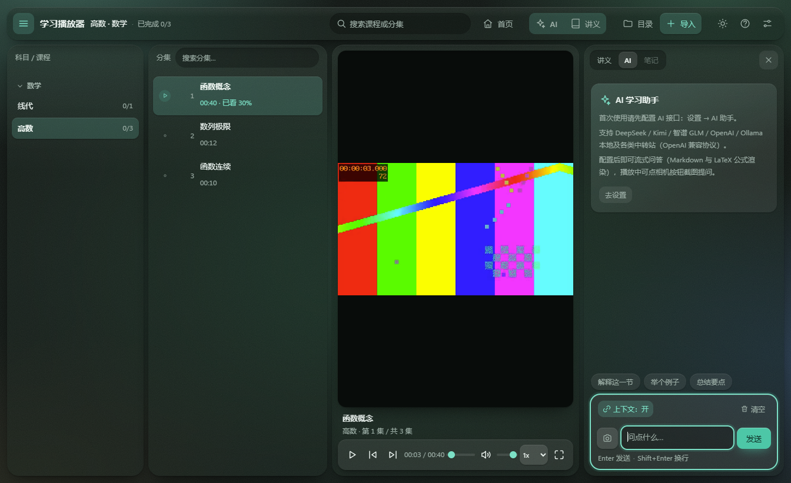
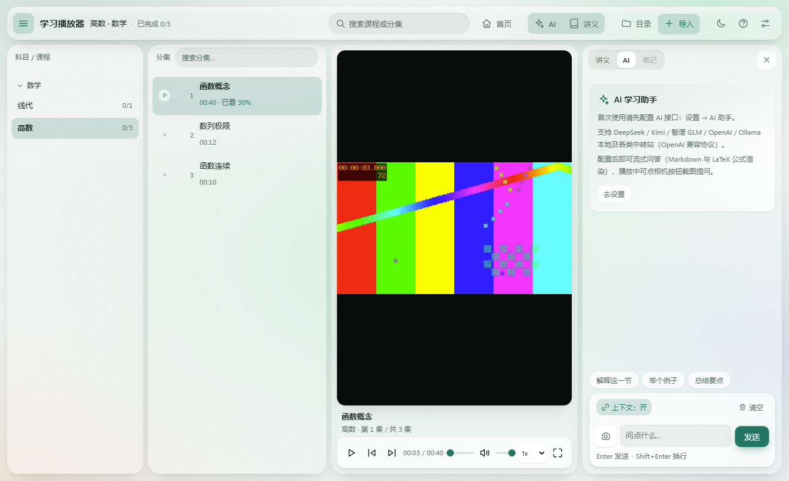

# 学习播放器

把硬盘里的网课视频按「科目 → 课程 → 分集」自动整理的本地视频学习播放器，带续播、学习看板、讲义关联和 AI 提问侧边栏。

| 深色 | 浅色 |
|:---:|:---:|
|  |  |
| 课程页 | 课程页 |
|  |  |
| 学习看板 | 学习看板 |
|  |  |
| AI 侧边栏 | AI 侧边栏 |

> 截图里的课程和彩条画面是自动化测试用的示例数据。

## 简介

长系列的网课视频下载下来，往往是一个个文件夹，加上 `[1.2.3]--标题.mp4` 这样的文件名。学习播放器不搬运、不改名，只读取目录结构和文件名，把它们整理成可以浏览的「科目 → 课程 → 分集」列表，并记住看到了哪里。

- **完全本地**：学习记录只保存在你自己的电脑上；除了你配置的 AI 接口，应用不发起网络请求。
- **不动原文件**：只读取目录，不移动、不改名、不修改任何视频。
- **Windows 桌面应用**：基于 Electron，不需要浏览器。

适合需要系统看完一套长课程的人，比如考研、网课和自学资料。

## 功能

- **目录自动整理**：指定学习目录，自动识别科目、课程和分集；按 `[1.2.10]` 这类编号排序，显示时去掉编号和扩展名。
- **续播与进度**：记住每一集看到的位置，重新打开接着看；自动标记未开始、看过一部分、已看完；可以开启播完自动连播。
- **学习看板**：继续学习、各科目进度、本周学习统计（活跃天数、看完集数、累计观看、今日时长）。
- **讲义关联**：课程文件夹里的 PDF、Word、PPT、Excel、TXT、图片自动归为讲义，按文件名里的编号匹配到对应分集，也可以手动关联。
- **转封装内播**：MKV、FLV 等浏览器不能直接播放的格式，在装有 ffmpeg 时转封装后可以直接在应用内播放。
- **AI 提问侧边栏**：接入任意 OpenAI 兼容接口，流式回答，支持 Markdown 和 LaTeX 公式，可以带着当前课程信息或视频截图提问。
- **导入与拖拽**：不在学习目录里的零散视频、课程文件夹、讲义，可以通过「导入」或拖进窗口加入。
- **其他**：全局搜索、深色 / 浅色主题、可拖动并记住宽度的三栏布局、主要的操作都能用键盘完成。

## 安装与运行

### 方式一：下载安装包

如果 [Releases](https://github.com/M4sh1r0-444/videoPlayer-M4/releases) 页面有发布版本，可以直接下载：

- `学习播放器-Setup-<版本>.exe`：安装版
- `学习播放器-Portable-<版本>.exe`：免安装，双击即用

仅支持 64 位 Windows。安装包没有数字签名，所以第一次运行时 Windows 可能提示「Windows 已保护你的电脑」，点「更多信息」→「仍要运行」即可。

没有可用的安装包时，用方式二从源码运行。

### 方式二：从源码运行

需要：

- Windows 10 及以上（已在 Windows 11 上验证）
- [Node.js](https://nodejs.org/) 22.12 或更高版本，以及 npm
- Git
- ffmpeg，可选，见[下文](#ffmpeg可选)

```bat
git clone https://github.com/M4sh1r0-444/videoPlayer-M4.git
cd videoPlayer-M4
npm ci
npm start
```

- **启动用 `npm start`。** 它会先构建再启动。构建产物不入库，跳过构建直接运行 `electron .`，界面不会加载。
- **首次 `npm ci` 会下载约 150 MB 的 Electron**，下载源是仓库 `.npmrc` 里配置的镜像。
- 如果安装时用了 `--ignore-scripts`，`npm start` 会在第一次启动时自动下载 Electron；也可以手动执行 `npx install-electron`。
- 镜像配置只对通过 npm 执行的命令生效。直连 GitHub 困难的环境下，不要绕过 npm 直接运行 `node_modules` 里的 `electron`。

## 上手指南

### 1. 添加学习目录

点顶栏的「目录」，选择存放课程的文件夹。应用按两条规则识别结构：

- 所选目录的某个一级文件夹里**直接有视频**：所选目录本身是一个科目，它的一级文件夹都是课程。
- 否则：一级文件夹里（往下最多两层）有视频的算科目，它们的子文件夹是课程。这种情况下，没有视频的文件夹会被忽略。

```text
示例 1：选择 D:\网课 作为学习目录
D:\网课\
├── 高数\                      一级文件夹里直接有视频
│   ├── [1.1.1]--函数.mp4      → 科目是「网课」，课程是「高数」「线代」
│   └── [1.1.2]--极限.mp4
└── 线代\
    └── 第1讲.mp4

示例 2：选择 F:\学习资料 作为学习目录
F:\学习资料\
├── 数学\                      一级文件夹本身没有视频，下级文件夹才有
│   ├── 高数\                  → 科目是「数学」「英语」，课程是各自的下级文件夹
│   │   └── [1.1.1]--函数.mp4
│   └── 线代\
│       └── 第1讲.mp4
└── 英语\
    └── 阅读\
        └── 第1讲.mp4
```

课程文件夹里的视频（往下最多两层）都会成为分集。文件名里 `[1.2.10]` 这类方括号编号按数值排序（所以 `[1.2.10]` 排在 `[1.2.9]` 后面），显示时去掉编号前缀和扩展名；没有编号的按中文自然序排列。隐藏文件夹和系统文件夹会被跳过。

能识别的文件：

- 视频：`mp4` `webm` `m4v` `ogv` `ogg` `mov` `mkv` `flv` `ts` `avi` `wmv` `rmvb` `mpg` `mpeg` `3gp`
- 讲义：`pdf` `doc` `docx` `ppt` `pptx` `xls` `xlsx` `txt` `jpg` `jpeg` `png`

### 2. 导入零散的文件

不在学习目录里的内容也可以加进来：

- 点顶栏的「导入」选择视频或讲义文件，或者把文件、文件夹直接拖进窗口；
- 在弹窗里选择归到哪个科目和课程，也可以新建。

导入只是登记路径，文件会留在原来的位置。拖入整个文件夹时，文件夹里的视频自动成为分集，文档自动归为讲义。

### 3. 日常使用

- 点分集开始播放。顶栏的「首页」切换到学习看板，「讲义」和「AI」打开右侧停靠区。
- 分集行上的「打开」会定位到视频文件，「讲义」打开对应的讲义文件。
- 鼠标悬停在分集上会显示预览，预览图需要 ffmpeg。
- 按顶栏右上角的 `?` 查看快捷键，齿轮图标打开设置。

<details>
<summary>快捷键完整列表</summary>

输入框获得焦点时，快捷键不会触发。

| 分类 | 按键 | 作用 |
|---|---|---|
| 播放 | `Space` | 播放 / 暂停 |
| 播放 | `←` / `→` | 快退 / 快进 5 秒（`Shift` 为 30 秒） |
| 播放 | `↑` / `↓` | 音量 ±5% |
| 播放 | `F` / 双击画面 | 全屏 |
| 播放 | `M` | 静音 / 取消静音 |
| 播放 | `N` / `P` | 下一集 / 上一集 |
| 播放 | `0`–`9` | 跳到 0%–90% |
| 全局 | `Ctrl+K` | 聚焦全局搜索 |
| 全局 | `Ctrl+I` | 打开 / 关闭 AI 页签 |
| 全局 | `?` | 打开快捷键帮助 |
| 全局 | `Esc` | 关闭弹窗 / 停靠区浮层 |
| 列表 / 侧栏 | `Tab` | 在按钮、侧栏、分集列表间移动 |
| 列表 / 侧栏 | `↑` / `↓` | 在分集列表中移动（列表获得焦点时） |
| 列表 / 侧栏 | `Enter` | 选课 / 播放当前分集 |

</details>

## ffmpeg（可选）

不装 ffmpeg 也能播放 mp4 等浏览器原生支持的格式。装了以后多出下面这些功能：

| 功能 | 有 ffmpeg | 没有 ffmpeg |
|---|---|---|
| 缩略图 | 看板「继续学习」卡片、分集悬停预览显示画面 | 不显示画面 |
| 时长 | 后台逐步读取每集时长，显示时长和已看百分比 | 不预先读取时长（播放过的分集除外），多数分集只显示已看位置 |
| 转封装内播 | MKV / FLV / TS 等可以在应用内播放 | 提示「需 ffmpeg 转封装后才能内播」 |
| AI 截图提问 | 可以截取当前画面 | 提示「未检测到 ffmpeg，无法截图」 |

**安装**，任选一种：

- Scoop：`scoop install ffmpeg`
- Chocolatey：`choco install ffmpeg`
- 手动：从 [gyan.dev](https://www.gyan.dev/ffmpeg/builds/) 下载 Windows 构建，解压到 `C:\ffmpeg\`，或者把解压后的 `bin` 目录加入 `PATH`

用 winget 或其他方式安装后，请用 `where ffmpeg` 确认它在 `PATH` 里；不在的话，需要手动把 `bin` 目录加入 `PATH`。

**应用查找 ffmpeg 的顺序**，取第一个可用的：

1. `PATH`（`where ffmpeg` 的第一个结果）
2. `D:\ffmpeg\bin`
3. `C:\ffmpeg\bin`
4. `C:\Program Files\ffmpeg\bin`
5. `%LOCALAPPDATA%\Programs\ffmpeg\bin`
6. `%USERPROFILE%\scoop\shims`

`ffmpeg` 和 `ffprobe` 必须在同一个文件夹里。应用运行期间只查找一次，装好或修改 `PATH` 之后需要重启应用。

## AI 助手（可选）

在「设置 → AI 助手」里配置：

1. 选一个预设（DeepSeek、Kimi、智谱 GLM、OpenAI、Ollama），或者选「自定义」。
2. 填写接口地址（OpenAI 兼容的 Base URL，含 `/v1`，不含 `/chat/completions`）、API Key 和模型名；可以按需追加系统提示词。
3. 点「测试连接」确认可用。

- 「上下文」开关打开时，当前课程、分集和播放位置会随提问一起发给 AI。
- 播放中可以点相机按钮截取当前画面，随下一条提问发送。截图需要 ffmpeg，并且要求模型支持图片输入。
- 对话记录保存在你的电脑上（`ai-history.json`），可以随时清空。

## 数据与隐私

所有数据都保存在 `%APPDATA%\学习播放器\`：

| 文件 / 目录 | 内容 |
|---|---|
| `learn.json` | 学习目录、导入的课程、观看进度、学习统计、设置、AI 配置（含 API Key） |
| `ai-history.json` | AI 对话记录 |
| `thumbnails\` | 缩略图缓存 |
| `remux\` | 转封装缓存（mp4） |

- 应用自身没有任何统计、遥测或上报代码，唯一的网络请求是发给你配置的 AI 接口。
- **API Key 以明文保存在 `learn.json` 里。** 不要把这个文件发给别人。
- 设置里的「打开数据文件夹」可以直接打开这个目录，「缓存管理」可以分别清理缩略图和转封装缓存。

## 已知限制

- 目前只在 Windows 上运行和验证过。
- 进度按视频的绝对路径记录。资料换了盘符或移动了位置后，需要重新添加学习目录，原有进度不会自动对应到新路径。
- 转封装只支持视频编码为 H.264、音频为 AAC 或 MP3 的文件。其他编码的 MKV、FLV 等需要用系统播放器打开。
- 「笔记」页签目前只是占位，功能还没有实现。
- 安装包没有数字签名。

## 开发

先按[方式二](#方式二从源码运行)装好依赖。

<details>
<summary>npm 脚本</summary>

| 命令 | 作用 |
|---|---|
| `npm start` | 构建并启动应用 |
| `npm run build` | 构建：校验 `renderer/vendor`，用 esbuild 打包渲染层，生成带内容哈希的入口 `renderer/dist/app.<hash>.js` |
| `npm test` | 单元测试（会先构建） |
| `npm run smoke` | 冒烟测试，见[测试](#测试) |
| `npm run smoke:packaged` | 对打包产物跑冒烟测试（先执行 `npm run dist:dir`） |
| `npm run smoke:baseline` | 重新生成视觉基线（截图、DOM 快照和说明），会覆盖 `docs/refactor/baseline/` |
| `npm run sync-vendor` | 把固定版本的 marked / DOMPurify / KaTeX 从 `node_modules` 同步到 `renderer/vendor` |
| `npm run fixture` | 生成冒烟测试用的媒体夹具（需要 ffmpeg） |
| `npm run icon` | 生成应用图标（Windows ICO 和 macOS ICNS / PNG） |
| `npm run icon:mac` | 只生成 macOS 图标 |
| `npm run dist` | 打包 Windows 安装版和便携版到 `dist/` |
| `npm run dist:dir` | 只打包出免安装目录 `dist/win-unpacked/` |
| `npm run dist:mac` | 打包 macOS dmg（只能在 macOS 上执行） |

</details>

<details>
<summary>目录结构</summary>

```text
main.js          主进程：目录扫描、数据存储、ffmpeg（缩略图 / 时长 / 转封装）、窗口与 IPC
ai-bridge.js     AI：流式对话、连接测试、截帧、对话记录文件
platform.js      平台相关：查找 ffmpeg、文件路径转 file:// URL
preload.js       预加载脚本：向渲染层暴露 window.api
renderer/        渲染层
  app.js         默认入口（组件化界面）
  index.html     页面骨架与 CSP
  style.css      全部样式
  views/         页面级视图
  components/    界面组件
  data/          状态、动作与持久化
  core/          纯函数（分集解析、讲义匹配、进度判定等），主进程与渲染层共用
  ui/            基础设施（DOM、对话框、快捷键、富文本渲染等）
  vendor/        marked / DOMPurify / KaTeX，由 npm run sync-vendor 同步，不要手改
  renderer.js    旧界面，连同 ai.js、lib-boot.js 只在 ?legacy=1 时加载
scripts/         构建、vendor 同步、冒烟测试、测试夹具、图标生成
test/            单元测试
build/           应用图标
docs/            设计与重构方案文档
ui-audit/        视觉抽查脚本
```

</details>

### 测试

```bat
npm test
npm run smoke
```

- `npm test`：单元测试（`node --test`），不需要额外环境。
- `npm run smoke`：用独立的临时数据目录启动真实的应用窗口，覆盖扫描、播放与续播、搜索、讲义、设置、导入、看板、键盘操作、AI（本地 mock 接口）和 `?legacy=1` 等链路，并把 DOM 快照与基线比对。注意：
  - 只支持 Windows，并且需要 ffmpeg 在 `PATH` 上；
  - 运行期间测试窗口必须保持可见（不要最小化、锁屏或切走桌面）：窗口不可见时，浏览器内核会把定时器节流到每秒一次并暂停动画帧，时序类断言会因此失败；
  - 每次运行都会重写 `docs/refactor/baseline/` 下 8 张基线截图（像素级的时序差异），跑完请用 `git checkout -- docs/refactor/baseline/` 还原；
  - 其中一项「真实 99 集」用例依赖开发者本地的一份数据快照，仓库里没有，所以克隆下来运行时这项会自动跳过。

### 打包

```bat
npm run dist
```

输出在 `dist/`：安装版 `学习播放器-Setup-<版本>.exe` 和便携版 `学习播放器-Portable-<版本>.exe`（x64），没有数字签名。打包过程需要联网下载 Electron 和打包工具。

## 许可证

[MIT](LICENSE)。设计与重构的背景文档在 [`docs/`](docs/) 目录里。

## macOS / Linux

代码里已经有平台分支（ffmpeg 改用 `which` 和 Homebrew / MacPorts 路径、可执行文件名不带 `.exe`、非 Windows 路径的处理）和 mac 打包配置（`npm run dist:mac`），但**没有在 macOS 或 Linux 上运行和验证过**，不保证可用。
