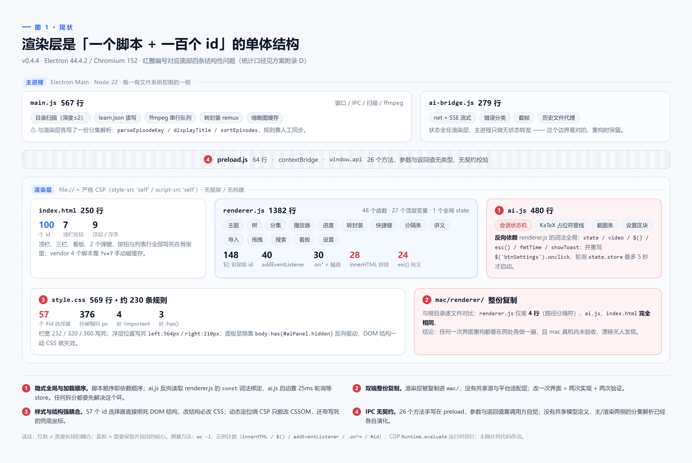
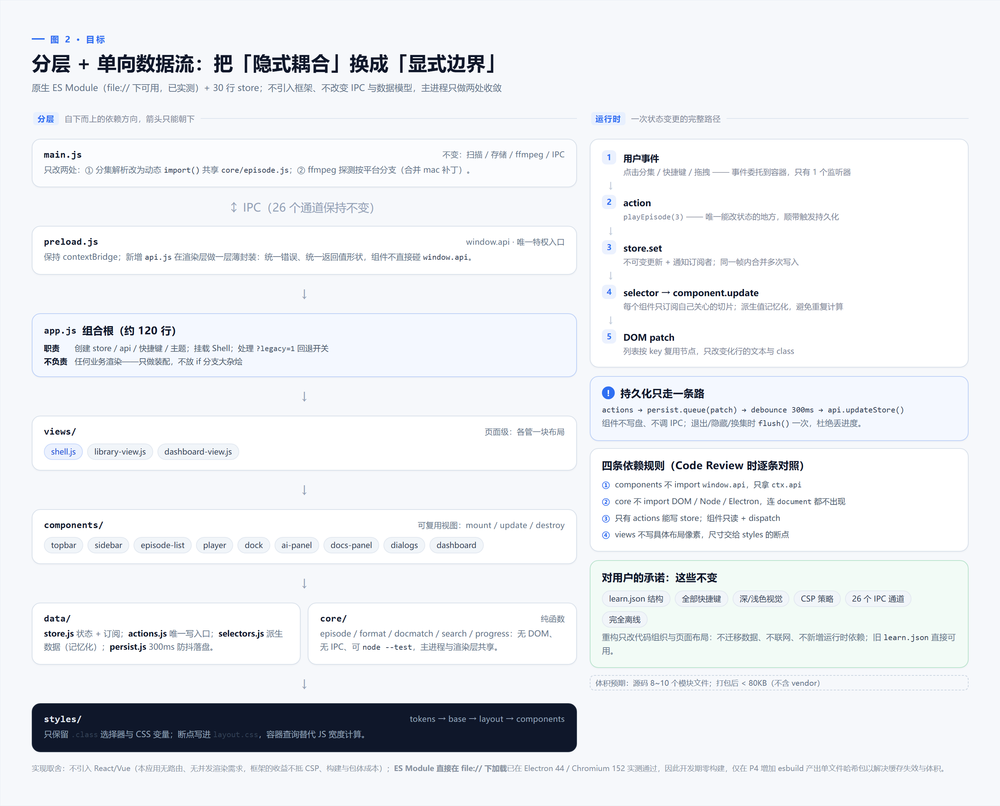
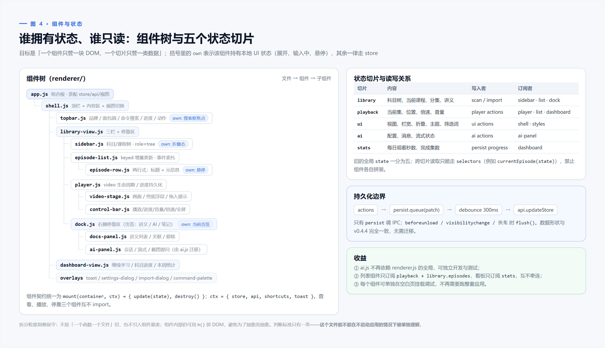
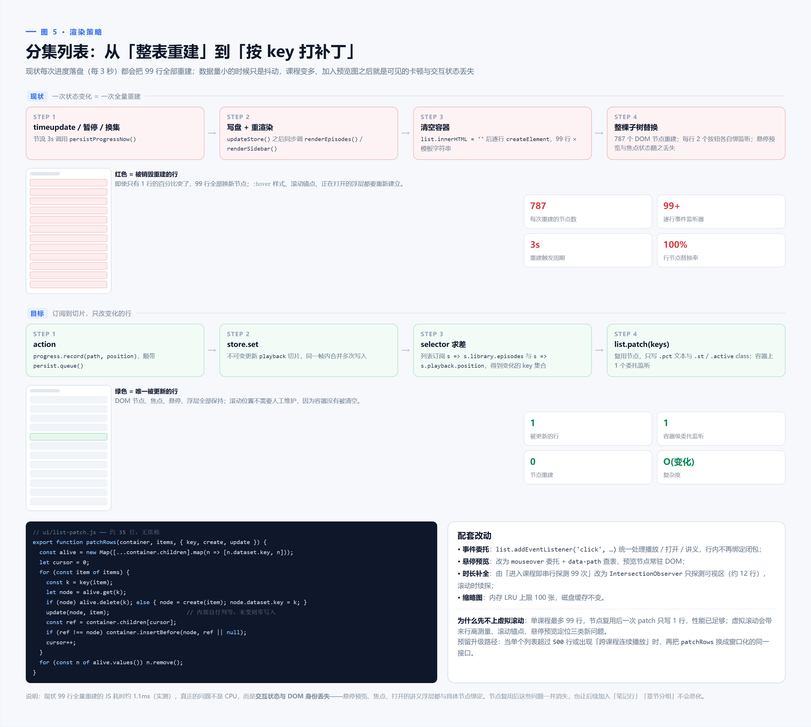
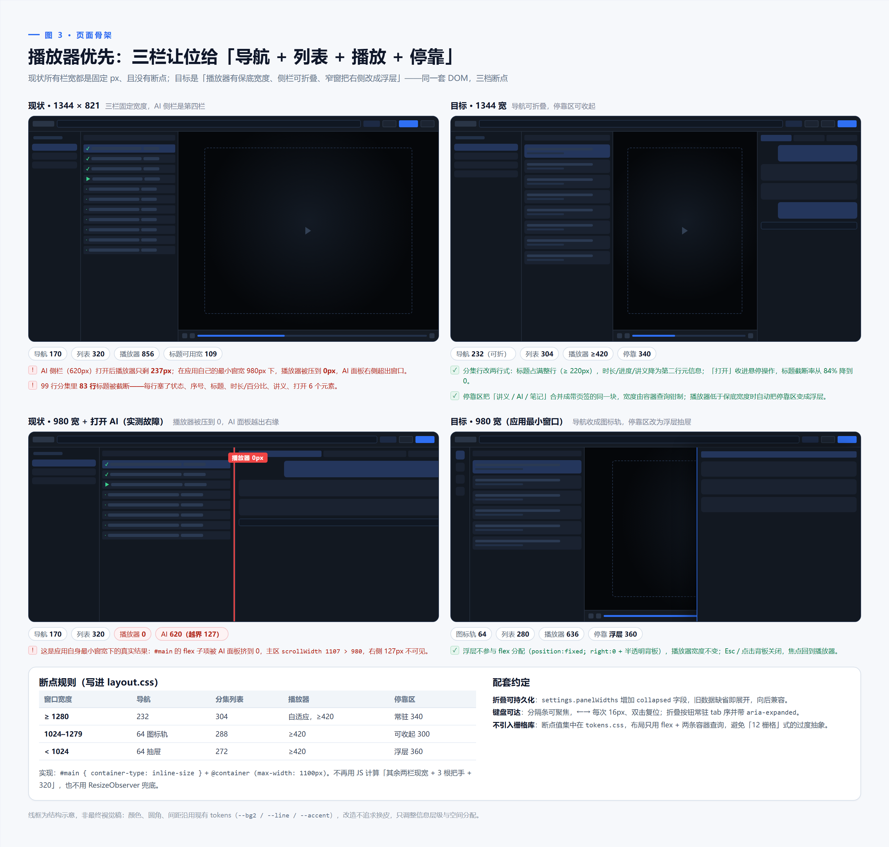
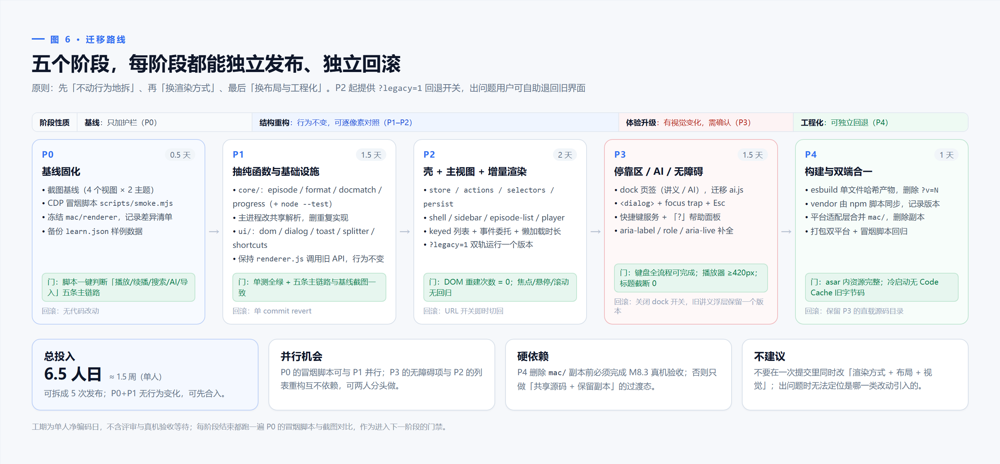

# 学习播放器 · 前端重构方案

> 基线版本：v0.4.4（Electron 44.4.2 / Chromium 152 / Node 22）｜ 提案日期：2026-10-22  
> 适用范围：`renderer/`（含 `mac/renderer/` 副本）、`preload.js`、`main.js` 中的共享逻辑  
> 配套示意图：图 1–图 6，源文件见 `docs/refactor/src/`  
> **进展**：P0 / P1 / P2 / P3 已完成（2026-10-22 ～ 10-23），交付与验证见 `docs/refactor/P0-P1-完成记录.md`、`docs/refactor/P2-完成记录.md`、`docs/refactor/P3-完成记录.md`；下一步 P4

**一句话**：把「一个 1382 行的全局脚本 + 100 个 id 的静态骨架 + 固定像素三栏」拆成有边界的模块与组件，用单向数据流和 keyed 列表增量更新替换全量重建，用断点布局替换拖拽钳制；全程不改数据格式、不改 IPC、不引入框架，分 5 次可回滚的发布完成。

**目录**：[0 摘要](#0-摘要) · [1 现状诊断](#1-现状诊断) · [2 目标与原则](#2-目标与原则) · [3 目标架构](#3-目标架构) · [4 页面方案](#4-页面方案图-3) · [5 迁移路线](#5-迁移路线图-6) · [6 验收与度量](#6-验收与度量) · [7 风险](#7-风险与对策) · [8 选型](#8-技术选型对比) · [9 附录](#9-附录)

---

## 0. 摘要

### 0.1 为什么现在做

1. **功能已经溢出结构。** 14 个功能域塞在 `renderer.js` 一个文件里（树、列表、播放器、进度、转封装、快捷键、分隔条、讲义、导入、拖拽、搜索、看板、设置、主题）；`ai.js` 反向依赖 `renderer.js` 的 6 个全局词法绑定（`state / video / $ / esc / fmtTime / showToast`），还要重写 `$('btnSettings').onclick`、轮询 `state.store` 才能启动。这不是「代码不够漂亮」，而是**再加功能只能继续往同一个文件里堆**。
2. **已经有可复现的用户可见缺陷。** AI 侧栏打开时播放器被压到 237px；在应用自己的最小窗宽 980px 下播放器宽度为 **0**、AI 面板右侧越出窗口 127px；99 集课程里 **83 集**标题被截断；进度每 3 秒触发一次整表重建，悬停预览/焦点状态随之丢失。
3. **双端复制让成本翻倍。** `mac/renderer/` 与根目录逐文件对比：`renderer.js` 只差 4 行（路径分隔符），`ai.js`、`index.html` 完全相同。任何一次界面重构都要写两遍、验两遍，而 mac 真机验收（M8.3）还没做，漂移没人会发现。

### 0.2 做什么

| 层 | 现在 | 目标 | 直接收益 |
|---|---|---|---|
| 结构 | 两个业务脚本（`renderer.js` / `ai.js`）共享全局词法作用域 | `core / data / ui / components / views / styles` 六层，依赖单向 | 单个文件可独立理解、独立测试 |
| 状态 | 1 个全局 `state`，函数直接改字段 | `store` 五切片 + `actions` 只写入入口 + `selectors` 派生 | 组件只订阅自己关心的数据 |
| 渲染 | 28 处 `innerHTML` 模板，整表重建 | `h()` 建节点 + keyed `patchRows` + 事件委托 | 只改变化的行，交互状态不丢 |
| 布局 | 固定 px + JS 钳制 + 无断点 | CSS 变量 + 容器查询 + 三档断点 + 停靠区 | 980px 窗口也能正常播放 |
| 样式 | 569 行单文件、57 个 `#id` 选择器 | tokens → base → layout → components，只保留 class | 改结构不用同步改 CSS |
| 交互 | 全局 blur 补丁、无 focus trap | `<dialog>` + 快捷键服务 + 焦点归还 | 键盘/读屏可用，自动化可测 |
| 工程 | 无构建、手动 `?v=N`、手拷 vendor | 可选 esbuild 单文件哈希产物 + npm 同步 vendor | 缓存失效这类坑消失 |
| 双端 | `mac/` 整份复制渲染层 | 单份源码 + 平台适配层 | 一次改动，两端生效 |

### 0.3 不做什么

- ❌ 不引入 React / Vue / Svelte，不引入路由、状态库、UI 组件库；
- ❌ 不做 TypeScript 全量迁移（P4 可选启用 `// @ts-check` + JSDoc，零构建成本）；
- ❌ 不改 `learn.json` 数据结构、不改 `productName`、不改 26 个 IPC 通道；
- ❌ 不改视觉语言（深色/浅色 tokens、圆角、间距全部沿用）；
- ❌ 不做移动端适配、不做云同步、不引入遥测。

### 0.4 投入与节奏

| 阶段 | 内容 | 工期 | 行为变化 |
|---|---|---|---|
| P0 | 基线固化（截图 + 冒烟脚本 + 冻结副本） | 0.5 天 | 无 |
| P1 | 抽 `core/` 纯函数与 `ui/` 基础设施 | 1.5 天 | 无（逐像素对照） |
| P2 | store + 壳 + 主视图 + 增量渲染 | 2 天 | 无（`?legacy=1` 双轨） |
| P3 | 停靠区 / AI / 无障碍 / 断点布局 | 1.5 天 | 有（已确认视觉并更新基线） |
| P4 | 构建、vendor、双端合一 | 1 天 | 无 |
| **合计** | | **6.5 人日** | |

### 0.5 验收底线（6 条，全部可测）

1. 980px 窗宽打开 AI / 讲义，播放器宽度 **≥ 420px**（现状 0px）；
2. 分集标题截断数 **= 0**（现状 83/99）；
3. 进度更新只触发 **1 行** DOM 写入（现状整表 99 行重建）；
4. 纯键盘可完成「选课 → 选集 → 播放 → 暂停 → 切集 → 开关 AI → 关弹窗」全流程；
5. 弹窗 Esc 可关、关闭后焦点回到触发按钮、Toast 可被读屏播报；
6. 冷启动、播放、续播、搜索、讲义、导入、转封装、AI 对话、截图提问与基线一致。

> **P3 验收结果**：上述 6 条已在 P3 全部通过（`npm run smoke` 101 条断言；真实 99 集标题截断 0；纯键盘链路、弹窗 Esc/焦点归还、Toast live region 均有自动断言）。逐项证据见 `docs/refactor/P3-完成记录.md` 第二节。
>
> **P4 验收结果**：构建产物与打包产物在同一套链路上复验通过（dev 118 条、packaged 27 条）；哈希构建/平台层未改变上述 6 条行为，DOM 快照与 P3 基线一致，视觉仅 dashboard 缩略图位图不同。证据见 `docs/refactor/P4-完成记录.md`。

---

## 1. 现状诊断

### 1.1 代码体检

| 文件 | 行数 | 职责 | 关键数字 |
|---|---:|---|---|
| `renderer/renderer.js` | 1382 | 除 AI 外的全部界面逻辑 | 48 个函数 · 27 个顶层变量 · 1 个全局 `state` · 148 次 `$()` · 40 个 `addEventListener` · 30 处 `.on*=` · 28 处 `innerHTML` · 24 次 `esc()` |
| `renderer/ai.js` | 480 | AI 侧栏全部逻辑 | 61 次 `$()` · 11 处 `.on*=` · 依赖 renderer.js 的 6 个全局 |
| `renderer/index.html` | 250 | 静态骨架 + CSP | 100 个 `id` · 7 个顶栏按钮 · 9 个浮层/浮条（另有 1 个动态创建的截图条） |
| `renderer/style.css` | 569 | 全部样式 | 约 227 条规则 · 57 个 `#id` 选择器 · 376 处 px 字面量 · 4 处 `!important` · 3 处 `:has()` |
| `preload.js` | 64 | contextBridge | 26 个 `window.api` 方法，全部无类型 |
| `main.js` | 567 | 扫描 / 存储 / ffmpeg / IPC | 与渲染层各一份分集解析 |
| `ai-bridge.js` | 279 | AI 网络与截帧 | 无状态转发，边界清晰 |
| `mac/renderer/*` | 同根目录 | 整份复制 | `renderer.js` 仅差 4 行，其余相同 |

> 统计口径：行数用 `wc -l`；`innerHTML / $() / addEventListener / .on*=` 用正则计数；`#id` 选择器按行首匹配；px 字面量统计声明中的 `\d+px`。均可在附录 D 复现。

### 1.2 问题 1：单体脚本与隐式全局（图 1）

**现象**

- `renderer.js` 顶层用 `const state = {...}` 保存全部应用状态，所有函数直接读写它；
- `ai.js` 顶部注释直言：「依赖 renderer.js 的全局词法声明：state / video / esc / fmtTime / showToast / $」；
- `ai.js` 用 25ms 间隔的 `await` 轮询等 store 就绪（最多 5 秒），再开始渲染；
- `ai.js` 通过「保存旧 `onclick` 再包一层」的方式挂进设置弹窗；
- 脚本执行顺序由 `index.html` 的 `<script>` 顺序隐式决定，任何一个文件挪位置都会静默失效。

**影响**：无法单独加载或测试 `ai.js`；重命名一个顶层变量就可能在不报错的情况下破坏另一个文件；任何「拆分」都必须先把这个环解开，否则只是把全局变量换个文件放。

### 1.3 问题 2：字符串模板 + 全量重建（图 5）

**现象**

- 列表行由模板字符串拼 HTML，再 `innerHTML` 赋值；34 处 `innerHTML` 赋值只有 28 处调用 `esc()`，且 `importSummary` 拼接文件名时没有转义（CSP 拦住了内联脚本，属低危，但模式本身不可持续）；
- 每次进度状态变化（每 3 秒 / 暂停 / 换集）都会 `renderEpisodes()`：清空容器 → 重建 99 行 → 每行重新绑定 1~2 个按钮闭包；
- 悬停预览、行内按钮焦点、正在打开的讲义浮层都挂在具体行节点上，节点被替换后状态自然丢失。

**实测**：99 行时 Dom 节点 787 个、单次重建 JS 1.1ms。**CPU 不是瓶颈，DOM 身份丢失才是**——这也解释了为什么「明明不卡，但浮层偶尔不消失/焦点莫名跳走」。

### 1.4 问题 3：固定像素布局，没有断点（图 3）

**现象**

- 栏宽写死：`#sidebar 232px`、`#episodePanel 320px`、`#aiPanel 360px`，用户拖拽后的宽度以 px 存进 `settings.panelWidths`；
- 分隔条钳制靠 JS 计算 `clientWidth - 其余两栏现宽 - 21 - 320`，把「播放器最小 320px」写成一个魔法数；
- 悬停预览与讲义浮层的位置写死：`left: 564px`、`right: 210px`；
- 面板显隐由 CSS `body:has(#aiPanel.hidden) #aiSplit` 反向跟随 JS 的 class。

**实测（CDP）**

| 场景 | 播放器宽度 | 结果 |
|---|---:|---|
| 1344×821，AI 关闭 | 856px | 正常 |
| 1344×821，AI 打开（宽 620） | 237px | 画面几乎不可用 |
| 980×760（应用最小窗宽），AI 打开（宽 620） | **0px** | 主区 `scrollWidth 1107 > 980`，AI 右侧 127px 不可见 |

**影响**：应用声明支持到 980px 宽，但在这个宽度下打开 AI 就等于「播放器消失」；新增第三块侧栏（笔记/讲义）时无处安放。

> 说明：980px 用例沿用了用户拖拽后的 AI 宽度上限 620px；即便按默认 360px，按各栏声明宽度计算播放器也只剩约 130px。根因是布局**没有任何最小宽度约束**，而不是某个具体宽度值。

下面是两张实拍（v0.4.4 本机运行，未做任何修改），可与上面的表格数字对照：

| 1344px + AI（620px） | 980px + AI（620px） |
|---|---|
|  |  |
| 播放器 237px，画面被压成窄条 | 播放器 0px；AI 头部“上下文”被右缘截断 |

### 1.5 问题 4：键盘与可访问性

**现象**

- 因为 Chromium 点击非可聚焦元素不会移走焦点，`renderer.js` 末尾加了约 30 行「全局 click 委托 blur」补丁（点按钮后 blur、点 range 后 blur、点空白处 blur 输入框）。这本身说明**焦点管理缺失**，只能事后打补丁；
- 5 个播放控制按钮（播放/上一集/下一集/静音/全屏）只有 emoji 字符，没有 `aria-label`；
- 设置/导入弹窗是普通 `div.modal`，没有 `role="dialog"`、`aria-modal`，打开时不移动焦点、不锁定 tab、**Esc 关不掉**（只有全局搜索的下拉处理了 Esc）；
- Toast 是 `div#toast`，没有 `role="status"` / `aria-live`，读屏不会播报；
- 科目树与分集列表没有 `role="tree"` / `listbox`，也没有方向键导航。

**影响**：读屏用户基本不可用；键盘用户会被「焦点困在某个按钮上」；UI 自动化只能靠坐标或 aria-label 碰运气（交接文档里 UIA 的坑已经记过一次）。

### 1.6 问题 5：工程化缺口与双端复制

- 无构建、无测试、无 lint；`?v=7` 靠人工递增来绕开 Code Cache 旧字节码；
- vendor 三件（marked / DOMPurify / KaTeX + 20 个字体）手工拷入，版本只存在于文件名之外；
- `mac/` 把渲染层整份复制，靠 README 的「同步清单」人工对齐。

**影响**：每一次改动都缺少「改错了会立刻知道」的护栏；双端复制让同一个 bug 要修两次、验两次。

### 1.7 问题 6：主进程与渲染层各写一套分集解析

`parseEpisodeKey / displayTitle / sortEpisodes` 在 `main.js` 与 `renderer.js` 各有一份；讲义的匹配更明显——主进程 `attachDocs` 只认阿拉伯数字，渲染层 `matchDocs` 还支持「第X讲/集/课」中文数字，且会用手动绑定优先。主进程算出的 `episodeIndex` 实际上随后被渲染层覆盖，属于**冗余且有分叉风险**的实现。



*图 1｜现状：主进程 / 预加载 / 渲染层三层与四条结构性问题（红框 = 要拆掉的耦合，蓝框 = 要保留并抽出的核心）*

---

## 2. 目标与原则

### 2.1 目标（可度量）

| 编号 | 目标 | 判定 |
|---|---|---|
| G1 | 渲染层无「隐式全局」：任何模块的依赖都写在 import 里 | `renderer.js` 中不再出现跨文件 `state` 引用 |
| G2 | 页面在 980px 宽下完整可用 | 播放器 ≥ 420px，无横向溢出 |
| G3 | 列表更新为 O(变化行) | 进度变化时 DOM 写入 ≤ 2 行 |
| G4 | 键盘与读屏可完成主流程 | 焦点陷阱、Esc、aria-label、live region 全部到位 |
| G5 | 双端一份渲染层源码 | `mac/renderer/` 删除，平台差异集中在 3 处适配 |

### 2.2 六条原则

1. **行为优先**：P1、P2 不改视觉和交互，只换代码组织与渲染方式；有视觉变化的只有 P3。
2. **边界显式**：依赖方向单向（views → components → data → core；styles 独立），跨层引用视为 review 阻断项。
3. **小步可回滚**：每阶段独立发布；P2 起带 `?legacy=1` 开关，用户可自助退回旧界面。
4. **不破约束**：CSP 不放宽、file:// 直链不改、完全离线、无运行时依赖。
5. **单一真相**：状态只有 store、颜色只有 tokens、平台差异只有适配层。
6. **先测后改**：`core` 纯函数先有单测；每次发布跑冒烟脚本 + 截图对比。

---

## 3. 目标架构

### 3.1 分层（图 2）

```
main.js（扫描 / 存储 / ffmpeg / 窗口）      ai-bridge.js（网络与截帧，无状态）
        │  IPC 26 个通道不变
   preload.js（contextBridge，唯一特权入口）
        │
   app.js（组合根：装配 store / api / 快捷键 / 主题）
        ├── views/        页面级：shell · library-view · dashboard-view
        ├── components/   组件：topbar · sidebar · episode-list · player · dock · dialogs
        ├── data/         store · actions · selectors · persist
        ├── ui/           dom · dialog · toast · splitter · list-patch · shortcuts
        └── core/         纯函数：episode · format · docmatch · search · progress
   styles/               tokens → base → layout → components
```

依赖只能自上而下。**唯一的例外**是 `core/`：主进程与渲染层共享同一份源码（P1 落地）。



*图 2｜目标分层、一次状态变更的完整路径、四条依赖规则*

### 3.2 目标目录

```
renderer/
├─ index.html                 骨架 + CSP + 一个 <script type="module" src="app.js">
├─ app.js                     组合根（≈120 行）
├─ core/
│  ├─ episode.js              parseEpisodeKey / displayTitle / sortEpisodes / makeEpisode
│  ├─ format.js               fmtTime / fmtDur / fmtBytes / localDateKey
│  ├─ docmatch.js             cnToInt / docNumbers / matchDocs
│  ├─ search.js               跨科目/课程/分集检索（纯函数）
│  └─ progress.js             完成度 / 续播判定 / 每日增量
├─ data/
│  ├─ api.js                  window.api 的唯一封装（错误归一化）
│  ├─ store.js                createStore + subscribe(selector)
│  ├─ selectors.js            courseStats / currentEpisode / weekStats（记忆化）
│  ├─ actions.js              所有状态变更入口
│  └─ persist.js              300ms 防抖 + flush
├─ ui/
│  ├─ dom.js                  h() / text() / delegate()
│  ├─ dialog.js               <dialog> 封装：焦点陷阱、Esc、焦点归还
│  ├─ toast.js                role=status
│  ├─ splitter.js             分隔条（含键盘调整）
│  ├─ list-patch.js           keyed 增量更新
│  └─ shortcuts.js            快捷键注册表 + 作用域
├─ components/                topbar / sidebar / episode-list / episode-row / player
│                             / video-stage / control-bar / dock / docs-panel
│                             / ai-panel / settings-dialog / import-dialog
├─ views/                     shell / library-view / dashboard-view
├─ styles/                    tokens · base · layout · components/*.css
└─ vendor/                    marked / dompurify / katex（保留，版本记录在 vendor/README.md）
```

> **P4 落地**：`app.js` + core/ui/data/components 由 esbuild 打进 `renderer/dist/app.<hash>.js`；marked / DOMPurify / KaTeX 三个 UMD 以固定顺序拼成同一入口的前导，`katex.min.css` 与 20 个 woff2 仍外链。`index.html` 只保留 1 个哈希脚本，`lib-boot.js` 只服务 `?legacy=1`。vendor 的版本/许可证/sha256 见 `renderer/vendor/README.md` 与 `manifest.json`。

### 3.3 模块契约

| 模块 | 允许依赖 | 禁止 | 典型代码 |
|---|---|---|---|
| `core/*` | 仅标准 JS | DOM、`window`、`node:*`、`electron` | `export function sortEpisodes(list)` |
| `data/*` | `core`、`api.js` | DOM、组件 | `store.set({...})` |
| `ui/*` | DOM（仅基础封装） | `data`、`core`、业务常量 | `dialog.open(node)` |
| `components/*` | `ui`、`core`（格式化） | `window.api`、直接改 store | `ctx.store.dispatch('play', i)` |
| `views/*` | `components`、`data`（只读 + dispatch） | 具体像素值 | `mountLibrary(root, ctx)` |
| `app.js` | 全部 | 业务逻辑 | 装配与启动 |

组件统一契约：

```js
export function createEpisodeList(ctx) {
  let el, unsubscribe;
  return {
    mount(container) { el = h('div', { class: 'ep-list', role: 'listbox' }); container.append(el); },
    update(state) { patchRows(el, rowsOf(state), { key, create, update }); },
    destroy() { unsubscribe?.(); el?.remove(); },
  };
}
```



*图 4｜组件树、五个状态切片与持久化边界（`own` 表示组件本地 UI 状态，其余一律走 store）*

### 3.4 状态模型

五个切片，互不直接引用：

| 切片 | 内容 | 写入者 | 订阅者 |
|---|---|---|---|
| `library` | 科目树、当前课程、分集、讲义 | scan / import | sidebar、episode-list、dock |
| `playback` | 当前集、位置、倍速、音量、转封装状态 | player actions | player、episode-list、dashboard |
| `ui` | 视图、栏宽、折叠、主题、筛选词 | ui actions | shell、layout |
| `ai` | 配置、消息、流式状态 | ai actions | ai-panel |
| `stats` | 每日观看秒数、完成集数 | persist | dashboard |

```js
// data/store.js —— 约 30 行
export function createStore(initial) {
  let state = initial;
  const subs = new Set();
  return {
    get: () => state,
    set(patch) {
      const next = typeof patch === 'function' ? patch(state) : { ...state, ...patch };
      if (next === state) return;
      state = next;
      for (const run of subs) run(state);
    },
    subscribe(selector, cb, equals = Object.is) {
      let prev = selector(state);
      const run = (s) => {
        const v = selector(s);
        if (!equals(v, prev)) { const old = prev; prev = v; cb(v, old); }
      };
      subs.add(run);
      return () => subs.delete(run);
    },
  };
}
```

```js
// data/actions.js —— 唯一写入口，示例
export function playEpisode(ctx, index, { autoplay = true } = {}) {
  const { library, playback } = ctx.store.get();
  const ep = library.episodes[index];
  if (!ep) return;
  ctx.store.set((s) => ({ ...s, playback: { ...s.playback, index, lastPos: null } }));
  ctx.persist.queue({ settings: { lastEpisodePath: ep.path } });
  ctx.player.load(ep, { autoplay });
}
```

**持久化只有一条路**：`actions → persist.queue(patch) → debounce 300ms → api.updateStore()`；组件不写盘、不调 IPC；`beforeunload / visibilitychange / 换集` 时 `flush()`。数据形状与 v0.4.4 完全一致，无需迁移。

### 3.5 渲染策略（图 5）

```js
// ui/list-patch.js —— 约 35 行，无依赖
export function patchRows(container, items, { key, create, update }) {
  const alive = new Map([...container.children].map((n) => [n.dataset.key, n]));
  let cursor = 0;
  for (const item of items) {
    const k = key(item);
    let node = alive.get(k);
    if (node) alive.delete(k);
    else { node = create(item); node.dataset.key = k; }
    update(node, item);                       // 内部判等，未变则零写入
    const ref = container.children[cursor];
    if (ref !== node) container.insertBefore(node, ref || null);
    cursor++;
  }
  for (const n of alive.values()) n.remove();
}
```

配套三项：

1. **事件委托**：`list.addEventListener('click', …)` 统一处理播放/打开/讲义，行内不再绑定闭包；
2. **悬停预览**：`mouseover` 委托 + `data-path` 查表，预览节点常驻 DOM；
3. **懒加载**：未播放分集的时长探测从「进入课程即串行 99 次」改为 `IntersectionObserver` 只探可视区（约 12 行），滚动续探；缩略图内存 LRU 上限 100 张。

> 不上虚拟滚动：单课程最多 99 行，节点复用后一次 patch 只写 1 行；虚拟滚动会引入行高测量、滚动锚点、悬停定位三类新问题。预留升级路径：单列表超过 500 行时把 `patchRows` 换成窗口化实现，接口不变。



*图 5｜全量重建与 keyed patch 的对比：节点身份、监听器数量、更新复杂度*

### 3.6 样式系统

**tokens**（把现在散落的 px 收敛成变量）：

```css
:root {
  --nav-w: 232px; --list-w: 304px; --dock-w: 340px;
  --player-min: 420px; --gap: 8px; --radius: 8px;
  --h-topbar: 48px; --h-row: 32px;
  --focus-ring: 0 0 0 2px color-mix(in srgb, var(--accent) 60%, transparent);
}
```

**文件拆分**：`tokens.css`（只有变量）→ `base.css`（reset / 滚动条 / focus-visible）→ `layout.css`（shell 栅格、断点、折叠态）→ `components/*.css`（每个组件一份）。

**必须替换的三类写法**：

| 现在 | 替换为 | 原因 |
|---|---|---|
| `#aiPanel.hidden` + `body:has(...)` 控制布局 | 容器上的 `data-*` 状态类 | `:has()` 让「显隐」与「布局」互相反向依赖 |
| JS 计算栏宽上限（`-21-320`） | `@container` 断点 + `flex-basis` | 魔法数散落在 JS，改布局要改逻辑 |
| 浮层 `left: 564px / right: 210px` | `position: absolute` 相对父容器或 `popover` 定位 | 硬编码坐标在窗口变化时失准 |

### 3.7 可访问性与键盘

- **弹窗改用原生 `<dialog>`**：`showModal()` 自带焦点陷阱、Esc 关闭、`::backdrop`；关闭时把焦点还给触发按钮；
- **语义补齐**：科目树 `role="tree"` + `aria-expanded`，分集列表 `role="listbox"` + `aria-selected`，播放控制加 `aria-label`，Toast 加 `role="status" aria-live="polite"`；
- **快捷键服务**：注册表 + 作用域（`global` / `player` / `dialog` / `input`），输入框聚焦时自动压入 `input` 作用域，不再靠「全局 blur 补丁」；
- **帮助面板**：按 `?` 打开快捷键一览（也解决「快捷键只有作者知道」的问题）。

### 3.8 安全与 CSP

保持现有 CSP 不放宽：

```
default-src 'self'; media-src media: file:; img-src 'self' file: data:;
font-src 'self' file: data:; style-src 'self'; script-src 'self'
```

- 新代码一律 `h()` + `textContent`，不再拼接 `innerHTML`；富文本只走现有的 DOMPurify 管线；
- 不引入需要 `unsafe-eval` / 内联样式的库（这是不选 styled-components、Vue runtime 编译器的原因之一）；
- `style` 属性仍不可用；需要动态尺寸时只改 CSSOM 变量（`el.style.setProperty('--w', …)`），已验证不受 CSP 限制。

### 3.9 主进程与共享 core

`core/` 写成 ESM，`main.js` 用动态 `import()` 加载（Node 22 支持从 CJS 动态导入 ESM）：

```js
// main.js 启动阶段
const { pathToFileURL } = require('node:url');
const path = require('node:path');
const coreEpisode = await import(pathToFileURL(path.join(__dirname, 'renderer/core/episode.js')).href);
const { makeEpisode, sortEpisodes } = coreEpisode;
```

同时删除 `main.js` 里重复的 `parseEpisodeKey / displayTitle / sortEpisodes` 与 `attachDocs`（其匹配结果本来就被渲染层覆盖）。**注意**：`core/` 不得出现 DOM 或 Electron API，否则主进程无法加载。

---

## 4. 页面方案（图 3）



*图 3｜1344px 与 980px 下的现状 / 目标线框，以及三档断点规则*

### 4.1 信息架构调整

| 区域 | 现状 | 目标 | 理由 |
|---|---|---|---|
| 顶栏 | 品牌 + 课程名 + 搜索框 + 7 个平级按钮 | 品牌 · 面包屑 · 命令搜索（Ctrl+K） · 进度 · 主操作 + 图标动作 | 7 个按钮没有主次，窗口一窄就挤 |
| 左栏 | 232px 固定，科目折叠 | 232 / 64 图标轨 / 抽屉三态，可记忆 | 窄窗优先保播放器 |
| 分集行 | 一行塞 6 个元素，标题 109px | 两行式：标题满宽 + 元信息行；操作悬停出现 | 83/99 截断的直接解法 |
| 播放器 | 无最小宽度，可被挤到 0 | `min-width: var(--player-min)`，低于阈值时停靠区转浮层 | 播放器是主任务 |
| 右侧 | 讲义浮层 + AI 侧栏两个独立东西 | 统一停靠区，页签：讲义 / AI / 笔记（预留） | 少一个面板，多一块空间 |
| 看板 | 独立全屏视图，内容稀疏 | 保持独立视图，补「最近学习/继续」与空状态排版 | 不是本次重点，只做布局约束 |

### 4.2 分集行重设计

```
┌───────────────────────────────────────────────┐
│ ✔  12  高数1-3-1 函数极限的定义与性质            │  ← 标题占满，最多两行
│         39:57 · 已看 88% · 📄讲义            ⋯ │  ← 元信息行；悬停时右侧出现「⋯」
└───────────────────────────────────────────────┘
```

- 状态用 16px 宽图标列（✔ / ▶ / ·），不再占用标题空间；
- 「打开文件夹」「打开讲义」「标记未看」收进悬停/聚焦出现的 `⋯` 菜单；
- 行高 44~48px（可点击区域更大），保持键盘可达与 `aria-selected`。

### 4.3 断点

| 窗口宽度 | 导航 | 分集列表 | 播放器 | 停靠区 |
|---|---:|---:|---|---|
| ≥ 1280 | 232 | 304 | 自适应，≥420 | 常驻 340 |
| 1024–1279 | 64 图标轨 | 288 | ≥420 | 可收起 300 |
| < 1024 | 64 抽屉 | 272 | ≥420 | 浮层 360（不参与 flex） |

实现：`#main { container-type: inline-size }` + 两条 `@container`，不再用 JS 计算与 `ResizeObserver` 兜底。

### 4.4 停靠区

- 页签「讲义 / AI / 笔记」共用一块宽度与一套折叠逻辑；
- AI 面板从「挤压布局的第四栏」变成「停靠区的一个页签」；
- 浮层模式下带半透明背板，Esc / 点击背板关闭，焦点回到播放器；
- 全屏播放时停靠区整体隐藏（沿用现有 `:fullscreen` 规则）。

### 4.5 保留的视觉语言

深色底 `#101318`、面板 `#171b22`、强调色 `#4f8cff`、8~12px 圆角、12~14px 字号、紧凑行高——这些不变。本次是**结构与空间分配**的重构，不是换皮。

---

## 5. 迁移路线（图 6）



*图 6｜五个阶段、工期、验收门与回滚方式*

### P0 · 基线固化（0.5 天）

- 用 CDP 截 4 个视图 × 2 主题共 8 张基线图（空状态、课程、AI、看板）；
- 写 `scripts/smoke.mjs`：以 `--remote-debugging-port` 启动，覆盖「播放/续播/搜索/AI/导入」五条主链路，退出码即结论；
- 冻结 `mac/renderer/`，生成差异清单（后续 P4 用）；
- 备份一份真实 `learn.json` 作夹具。

**验收**：`npm run smoke` 在 v0.4.4 上全绿；8 张基线图入库。

### P1 · 抽纯函数与基础设施（1.5 天）

- `core/` 五个模块 + `node --test` 单测（从现有函数平移，逻辑不变）；
- `main.js` 改为共享 `core/episode.js`，删除重复实现与 `attachDocs`；
- `ui/` 的 `dom / dialog / toast / splitter / shortcuts` 落地；
- `renderer.js` 继续以旧方式调用，行为零变化。

**验收**：单测全绿；五条主链路与基线截图逐像素一致。

### P2 · 壳 + 主视图 + 增量渲染（2 天）

- store / actions / selectors / persist；
- shell、sidebar、episode-list、player 组件化；
- keyed 列表 + 事件委托 + 懒加载时长；
- `?legacy=1` 双轨运行一个版本。

**验收**：进度更新时 DOM 写入 ≤ 2 行；焦点、悬停、滚动、讲义浮层无回归；`?legacy=1` 能回到旧界面。

### P3 · 停靠区 / AI / 无障碍 / 断点（1.5 天，有视觉变化）

- dock 页签（讲义 / AI），迁移 `ai.js` 逻辑；
- `<dialog>` 替换两个弹窗；focus trap、Esc、焦点归还；
- 快捷键服务 + 「?」帮助面板；aria 全量补齐；
- 三档断点 + 折叠态持久化 + 980px 布局。

**验收**：0.5 节的 6 条底线全部通过；视觉稿确认（✅ 2026-10-23，见 `docs/refactor/P3-完成记录.md`）。

### P4 · 构建与双端合一（1 天）

- esbuild 产出 `app.<hash>.js`，`index.html` 由构建脚本注入哈希，删除 `?v=N`；
- `vendor` 由 npm 脚本同步并记录版本；
- 平台适配层合并 `mac/`，删除渲染层副本；
- 打包双平台 + 冒烟回归。

**验收**：asar 内资源完整；冷启动不再出现旧字节码；mac 真机验收（M8.3）通过后再删副本。**状态（2026-10-23）**：构建 / vendor / CSP / 平台层 / Windows 打包完成；`mac/` 删除被 M8.3 阻塞，见 `docs/refactor/P4-完成记录.md`。

### 依赖关系

```
P0 ── P1 ── P2 ── P3 ── P4
        └──── 并行：单测 ←→ 冒烟脚本
P4 删除 mac 副本 ← 依赖 M8.3 真机验收
```

---

## 6. 验收与度量

### 6.1 功能回归清单

| # | 场景 | 判定 |
|---|---|---|
| 1 | 首次启动空状态 → 添加目录 → 自动选中首课 | 与基线一致 |
| 2 | 播放 / 暂停 / 进度拖动 / 音量 / 倍速 / 上下集 / 自动连播 | 与基线一致 |
| 3 | 退出重启 → 恢复上次课程、分集、播放位置 | 位置误差 < 1s |
| 4 | 搜索课程/分集 → 回车跳转并起播 | 与基线一致 |
| 5 | 讲义自动匹配 / 手动关联 / 移除 / 刷新 | 重启不复活、绑定生效 |
| 6 | 导入文件 / 文件夹 / 拖拽 / 新建科目课程 | 与基线一致 |
| 7 | MKV 转封装进度条 → 自动起播 → 重启秒开 | 与基线一致 |
| 8 | AI 配置 / 测试连接 / 流式 / 中断 / 截图提问 / 清空历史 | 与基线一致 |
| 9 | 白天/夜间、全屏、栏宽拖动 | 与基线一致（P3 后按新断点） |
| 10 | 无 ffmpeg 环境下的降级提示 | 与基线一致 |

### 6.2 量化指标

| 指标 | 现状 | 目标 | 测法 |
|---|---:|---:|---|
| 980px 窗宽 + AI 打开时播放器宽度 | 0px | ≥ 420px | CDP `getBoundingClientRect` |
| 1344px 窗宽 + AI 打开时播放器宽度 | 237px | ≥ 420px | 同上 |
| 99 行标题截断数 | 83 | 0 | `scrollWidth > clientWidth` 计数 |
| 进度更新触发 DOM 写入 | 99 行重建（787 节点） | ≤ 2 行 | MutationObserver 统计 |
| 行内事件绑定（onclick 闭包） | 99+ | 1（委托） | `getEventListeners` |
| 单课程时长补全的 ffprobe 次数 | 99 | ≤ 15（可视区） | 主进程计数 |
| 弹窗 Esc 可关闭 | 否 | 是 | 冒烟脚本 |
| 图标按钮有 `aria-label` | 0/5 | 5/5 | DOM 断言 |
| 冷启动脚本数 | 5 个 + 手动版本号 | 1 个哈希包 | 构建产物 |
| 渲染层最大单文件行数（不含 vendor） | 1382 | ≤ 250 | `wc -l` 排序取最大 |

> 行数不是越少越好：拆分通常会带来少量样板代码，目标是从「单文件 1382 行」变成「单文件 ≤ 250 行、每个文件职责可命名」。
>
> **P3 实测**：1344 + AI 播放器 468px、980 + AI/讲义 644px；真实 99 集（1344/980）标题截断 0；进度更新 1 行 DOM；列表容器 click 委托 1 个、行内 0；弹窗 Esc / 焦点陷阱 / 焦点归还、Toast live region、5/5 图标按钮 aria-label 均通过自动断言。行数目标尚未达成（见 P3 记录边界），不影响 0.5 节 6 条验收。
>
> **P4 实测**：冷启动只有 1 个哈希入口脚本（`renderer/dist/app.543ada0ec9.js`，445,693 B，含 marked/DOMPurify/KaTeX 前导），`index.html` 无 `?v=N`；`npm run smoke` 118/118，新增构建/asar/vendor/CSP 断言；打包版 27/27。单文件行数目标仍未达成（P5 技术债）。

### 6.3 自动化冒烟

```js
// scripts/smoke.mjs（P0 落地，约 150 行）
// 1) 子进程启动 electron --remote-debugging-port=9222 --user-data-dir=<tmp>
// 2) 连接 CDP：Runtime.evaluate 读取 state、点击、注入按键
// 3) 断言：标题存在、进度增长、AI 面板可开关、弹窗 Esc 关闭
// 4) 失败时保存截图到 .smoke/ 并退出码 1
```

关键点：用**临时 userData** 启动，避免污染用户真实进度；每次结束 `taskkill` 干净（交接文档里「后台 Electron 幽灵进程」的教训）。

### 6.4 截图基线

- 固定窗口 1344×821、固定夹具 `learn.json`；
- 8 张基线图存 `docs/refactor/baseline/`；
- 每次重构后人工比对（P0 可用像素差脚本辅助，但不作为唯一判据——GPU 抗锯齿会造成假阳性）。

### 6.5 性能预算

| 项 | 预算 |
|---|---|
| 首屏可交互（已缓存） | < 300ms |
| 课程切换（99 集） | < 100ms |
| 进度更新 | < 1ms + 1 次 DOM patch |
| 单文件体积（不含 vendor） | < 80KB |
| 渲染进程常驻内存 | 不高于现状 +10% |

---

## 7. 风险与对策

| 风险 | 影响 | 对策 |
|---|---|---|
| file:// 下 ES Module 加载在目标 Electron 版本被收紧 | 拆分方案失效 | P0 用 3 行探针复验（见附录 D）；失败则退回「单文件 IIFE + 构建」，模块代码不变，只换打包方式 |
| 移除 `?v=N` 后旧 Code Cache 仍在 | 用户看到旧逻辑 | 构建产物文件名带内容哈希，URL 变化即失效；发版前删一次 Code Cache 验证 |
| 组件化期间引入新的全局 | 旧问题复发 | Review 清单：组件文件不得出现 `window.api` / `state.` |
| 视觉调整被用户认为「换皮」 | 接受度低 | P1/P2 零视觉变化；P3 单独确认稿；保留 `?legacy=1` 一个版本 |
| mac 副本删除后真机问题无法回归 | 无法维护 | 删除前必须完成 M8.3 八项验收；否则只做「共享源码 + 副本只读」过渡 |
| 单实例锁 / 打包版并存导致测试假象 | 验收结论错误 | 冒烟脚本使用独立 userData + 启动前 `Get-Process` 检查 |
| 工期被「顺手优化」拉长 | 迟迟不发布 | 每阶段冻结范围；非清单内改动进 backlog |

---

## 8. 技术选型对比

| 维度（1–5） | A. 原生 ESM + 轻量自建 | B. Preact/Vue + Vite | C. 仅整理不拆分 |
|---|---:|---:|---:|
| 迁移成本（越低越好） | 2 | 4 | 1 |
| 与 CSP / file:// 的兼容 | 5 | 3（需构建，模板编译需评估） | 5 |
| 长期可维护性 | 4 | 5 | 1 |
| 包体与启动 | 5 | 3 | 5 |
| 团队心智负担 | 2 | 4（若已熟悉） | 1 |
| 本项目的收益/成本比 | **高** | 中 | 低 |

**推荐 A**：本应用是单窗口、无路由、无并发渲染、状态不复杂；框架带来的收益主要在「大型表单/复杂列表/团队协作」，而成本（构建链路、CSP 约束、包体、升级维护）在这个项目上是实打实的。

**升级触发器**（出现任一条再考虑 B）：

1. 单页组件数 > 40，或出现多个独立窗口；
2. 需要复杂列表（拖拽排序、分组虚拟化、内联编辑）超过 3 处；
3. 团队多人并行开发，需要更强的约定与类型检查。

---

## 9. 附录

### A. 组件清单

| 组件 | 源文件 | 负责 | 不负责 |
|---|---|---|---|
| `shell` | `views/shell.js` | 顶栏、内容区、视图切换 | 具体业务数据 |
| `sidebar` | `components/sidebar.js` | 科目/课程树、折叠 | 分集 |
| `episode-list` | `components/episode-list.js` | 列表 patch、委托、懒加载 | 播放 |
| `episode-row` | `components/episode-row.js` | 单行渲染与状态 | 全局状态 |
| `player` | `components/player.js` | video 生命周期、进度持久化 | 列表 |
| `video-stage` | `components/video-stage.js` | 画面、兜底浮层、拖入提示 | 控制条 |
| `control-bar` | `components/control-bar.js` | 播放/进度/音量/倍速/全屏 | 业务状态 |
| `dock` | `components/dock.js` | 页签、宽度、折叠 | 讲义/AI 内容 |
| `docs-panel` | `components/docs-panel.js` | 讲义列表/关联/移除 | 文件打开（走 api） |
| `ai-panel` | `components/ai-panel.js` | 会话/流式/截图 | 网络（主进程） |
| `settings-dialog` | `components/settings-dialog.js` | 目录/缓存/AI 配置 | 状态持久化 |
| `dashboard` | `views/dashboard-view.js` | 继续学习/进度/统计 | 播放 |

### B. 快捷键（保持不变）

| 键 | 作用 | 备注 |
|---|---|---|
| `Space` | 播放/暂停 | 输入框聚焦时归输入框 |
| `← / →` | 快退/快进 5s（Shift 30s） | |
| `↑ / ↓` | 音量 ±5% | |
| `F` / 双击画面 | 全屏 | |
| `M` / `N` / `P` | 静音 / 下一集 / 上一集 | |
| `0–9` | 跳到 0%–90% | |
| `Ctrl+K` | 全局搜索 | |
| `Ctrl+I` | AI 侧栏开关 | |
| `?` | 快捷键帮助 | 新增 |
| `Esc` | 关闭弹窗/浮层 | 新增 |

### C. IPC 通道（保持不变）

`pick-folders`、`pick-files`、`scan-roots`、`scan-course`、`open-user-data`、`get-store`、`update-store`、`episode-meta`、`remux-start`、`remux-status`、`remux-check`、`cache-stats`、`cache-clear`、`reveal`、`open-path`、`drop-paths`、`ai-save-config`、`ai-test`、`ai-send`、`ai-abort`、`ai-history-load`、`ai-history-save`、`ai-history-clear`、`ai-capture-frame`、`ai:chunk/done/error`、`ai.onAiEvent`。

> 重构不改通道；只在 `data/api.js` 统一封装参数形状与错误。

### D. 度量方法

```js
// 在 DevTools / CDP Runtime.evaluate 中执行
const q = (s) => document.querySelectorAll(s).length;
({
  ids: q('[id]'),
  rows: q('.ep-row'),
  truncated: [...document.querySelectorAll('.ep-row .title')]
    .filter((t) => t.scrollWidth > t.clientWidth + 1).length,
  domNodes: q('*'),
  playerWidth: Math.round(document.getElementById('playerPanel').getBoundingClientRect().width),
  cssRules: [...document.styleSheets].reduce((n, s) => n + s.cssRules.length, 0),
});
```

```js
// file:// 下 ES Module 探针（P0 复验用）
import('./core/episode.js').then((m) => console.log('esm ok', !!m.sortEpisodes))
  .catch((e) => console.warn('esm blocked', e.message));
```

### E. 示意图源文件

`docs/refactor/src/` 下是 6 张图的 HTML 源（`fig01.html` ~ `fig06.html` + `styles.css`），可在浏览器打开、改文案后重新截图；截图为 2 倍像素输出，适配高分屏与打印。

| 图 | 文件 | 内容 |
|---|---|---|
| 图 1 | `refactor/图1-现状架构与耦合.png` | 现状分层、耦合点、四条结构性问题 |
| 图 2 | `refactor/图2-目标分层与数据流.png` | 六层架构、单向数据流、依赖规则 |
| 图 3 | `refactor/图3-页面布局对比.png` | 现状/目标 1344 与 980 线框、断点表 |
| 图 4 | `refactor/图4-组件树与状态边界.png` | 组件树、五个状态切片、持久化边界 |
| 图 5 | `refactor/图5-列表渲染策略.png` | 全量重建 vs keyed patch、代码骨架 |
| 图 6 | `refactor/图6-迁移路线.png` | 五阶段、工期、验收门、回滚 |

---

## 10. 实施状态与下一步

> 更新时间：2026-10-23

| 阶段 | 状态 | 交付 / 证据 |
|---|---|---|
| P0 | ✅ 完成 | 8 张截图 + DOM 快照 + `scripts/smoke.mjs` + 真实数据快照 |
| P1 | ✅ 完成 | `core/` + `ui/` + 24 条单测；见 `docs/refactor/P0-P1-完成记录.md` |
| P2 | ✅ 完成 | 数据层 + 增量列表 + 组件化主视图 + `?legacy=1`；见 `docs/refactor/P2-完成记录.md` |
| P3 | ✅ 完成 | 停靠区（讲义/AI/笔记占位）+ AI 迁移 + `<dialog>`/快捷键/aria + 三档断点；`npm test` 52/52、`npm run smoke` 101/101；见 `docs/refactor/P3-完成记录.md` |
| P4 | ✅ 完成（mac 删除待 M8.3） | 构建哈希 / vendor 同步 / CSP 富文本 / 平台层合并 / Windows 打包冒烟；`npm test` 74/74、`smoke` 118/118、`smoke:packaged` 27/27；见 `docs/refactor/P4-完成记录.md` |

默认入口是构建产物 `renderer/dist/app.<hash>.js`（内容哈希，无 `?v=N`）；`?legacy=1` 仍可回到旧 `renderer.js + ai.js`，建议保留一个版本（约 2 周）后删除。P3 起新路径不再加载旧 `ai.js`。`mac/` 仍保留，删除被 M8.3 真机验收阻塞。

### 下一步（P5 入口）

1. **删除双轨**：确认一个发布窗口无 `?legacy=1` 回退需求后，删旧 `renderer.js` / `ai.js` / `lib-boot.js` / 旧静态骨架与 `html[data-app-mode="legacy"]` 覆盖；同时删除 legacy smoke 分支与 `renderer/vendor` 的 UMD 兜底加载（入口已自带 vendor 前导）。
2. **双端收口**：完成 M8.3 mac 真机验收（用根目录 `npm run dist:mac`），再删 `mac/`、更新 `mac-freeze.json`；在此之前不得声称双端完成。
3. **技术债**：`actions.js` 按 library/playback/ui 分域、`style.css` 拆 tokens/base/layout/components；把 6.2 的 ≤250 行目标作为后续检查项；`build.files` 可逐步排除已不再运行时加载的 `renderer/views|components|data` 源码（仅体积优化）。
4. **P5 产品功能**：笔记本体的真正实现（当前 dock 仅有占位页签）、导出/同步等；不得触碰 `productName`、`learn.json` 结构、26 个 IPC、`main.js` 扫描算法、`ai-bridge.js`。
5. **回归门**：保留 `npm test` + `npm run smoke`（118 条）+ `npm run smoke:packaged`（27 条）+ 真实 99 集 + 纯键盘 + AI mock 链路；每次发版前跑 `npm run build` 两次确认 hash 一致。
